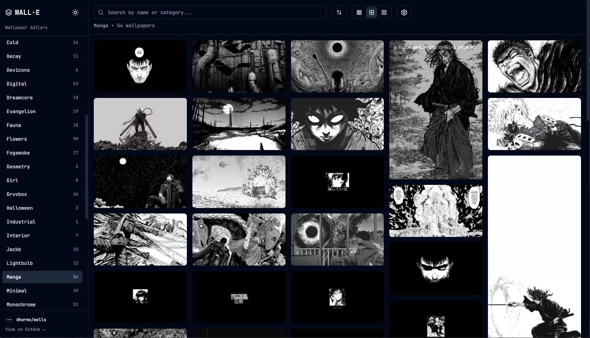

<div align="center">

# WALL·E Gallery

**Explora hermosos fondos de pantalla desde repositorios de GitHub con un rendimiento ultrarrápido y un diseño elegante**

[](https://walle.theblank.club)
[](https://react.dev)
[](https://www.typescriptlang.org)
[](https://vitejs.dev)
[](https://tailwindcss.com)
[](./LICENSE)



</div>

---

## ✨ Características

### 🎨 Soporte Multi-Fuente
- **Múltiples Motores** - Explora fondos de pantalla desde cualquier repositorio público de GitHub
- **11 Colecciones Integradas** - Repositorios preconfigurados con miles de fondos de pantalla
- **Motores Personalizados** - Agrega tus propios repositorios favoritos de fondos de pantalla
- **Cambio Fácil** - Cambia sin problemas entre diferentes fuentes de fondos de pantalla

### 🖼️ Experiencia de Galería
- **Diseño Masonry** - Cuadrícula hermosa y responsive que se adapta al tamaño de las imágenes
- **3 Tamaños de Miniatura** - Elige entre vistas de cuadrícula pequeña, mediana o grande
- **Navegación por Categorías** - Explora por categorías organizadas
- **Ordenamiento Inteligente** - Ordena por nombre o tamaño de archivo, ascendente o descendente
- **Búsqueda Potente** - Encuentra fondos de pantalla al instante por nombre o categoría
- **Desplazamiento Infinito** - Experiencia de navegación fluida con carga diferida

### 🚀 Rendimiento
- **Ultrarrápido** - 99.5% de reducción de ancho de banda con miniaturas optimizadas
- **Carga Progresiva** - Transiciones de difuminado a nítido para una experiencia fluida
- **Caché Inteligente** - Caché de datos por motor para cambios instantáneos
- **Eficiente en Memoria** - 90% de reducción de memoria comparado con cargar la resolución completa

### 🎯 Experiencia de Usuario
- **Vista Previa a Pantalla Completa** - Visualiza y descarga fondos de pantalla en calidad completa
- **Modo Oscuro/Claro** - Alterna entre temas con preferencia persistente
- **Configuración Persistente** - Todas las preferencias se guardan (tema, tamaño, orden, motor)
- **Diseño Responsive** - Funciona perfectamente en todos los dispositivos
- **Atajos de Teclado** - ESC para cerrar el modal, navegación intuitiva

## 🛠️ Stack Tecnológico

Construido con tecnologías web modernas para un rendimiento óptimo:

- **React 19** - La última versión de React con características concurrentes
- **TypeScript** - Seguridad de tipos completa en toda la base de código
- **Vite** - Herramienta de compilación y servidor de desarrollo ultrarrápido
- **Tailwind CSS v3** - Estilos basados en utilidades con tema personalizado
- **Lucide React** - Iconos hermosos y personalizables
- **GitHub API** - Integración directa con repositorios
- **wsrv.nl** - Proxy de optimización de imágenes

## 🚀 Comienzo Rápido

### Requisitos Previos

- Node.js 18+
- npm o yarn

### Instalación

```bash
# Install dependencies
npm install

# Start development server
npm run dev

# Build for production
npm run build

# Preview production build
npm run preview
```

La aplicación estará disponible en `http://localhost:5173/`

## 📁 Estructura del Proyecto

```
wall-e-gallery/
├── src/
│   ├── components/       # React components
│   │   ├── Button.tsx
│   │   ├── Input.tsx
│   │   ├── Sidebar.tsx
│   │   ├── SearchBar.tsx
│   │   ├── MasonryGallery.tsx
│   │   ├── ImageModal.tsx
│   │   └── InfiniteScrollTrigger.tsx
│   ├── hooks/           # Custom React hooks
│   │   ├── useTheme.ts
│   │   └── useInfiniteScroll.ts
│   ├── lib/             # Utilities and services
│   │   ├── utils.ts
│   │   └── github-api.ts
│   ├── types/           # TypeScript type definitions
│   │   └── index.ts
│   ├── App.tsx          # Main app component
│   ├── main.tsx         # App entry point
│   └── index.css        # Global styles
├── public/              # Static assets
└── ...config files
```

## 🔧 Cómo Funciona

La aplicación utiliza un sistema de motores sofisticado para explorar fondos de pantalla desde cualquier repositorio de GitHub:

1. **Selección de Motor** - Elige entre motores integrados o agrega repositorios personalizados
2. **Obtención del Árbol** - La API de GitHub obtiene la estructura completa del repositorio
3. **Caché Inteligente** - El caché por motor minimiza las llamadas a la API y permite cambios instantáneos
4. **Optimización de Imágenes** - Miniaturas generadas al vuelo a través del proxy wsrv.nl (10MB → 50KB)
5. **Carga Progresiva** - La galería muestra miniaturas, la resolución completa se carga solo en el modal
6. **Operaciones del Lado del Cliente** - Todo el filtrado, ordenamiento y búsqueda ocurre al instante sobre los datos en caché

### Endpoints de la API

```
GitHub API:
https://api.github.com/repos/{owner}/{repo}/git/trees/{sha}?recursive=1

Raw Images:
https://raw.githubusercontent.com/{owner}/{repo}/{branch}/{path}

Optimized Thumbnails:
https://wsrv.nl/?url={encoded-url}&w={width}&q={quality}&output=webp
```

## ⚡ Optimizaciones de Rendimiento

La aplicación implementa múltiples estrategias de rendimiento para manejar colecciones grandes de fondos de pantalla de manera eficiente:

### Optimización de Imágenes
- **Servicio de Proxy de Imágenes** - Utiliza wsrv.nl para generar miniaturas optimizadas (ancho de 400px, 80% de calidad, formato WebP)
- **Carga Progresiva** - Muestra las miniaturas primero y luego carga la resolución completa solo en el modal
- **Transición de Difuminado a Nítido** - Efecto visual suave durante la carga de imágenes
- **Carga Diferida (Lazy Loading)** - Carga diferida nativa del navegador con Intersection Observer
- **Formato WebP** - Conversión automática a WebP para una mejor compresión (50-80% más pequeño)

### Gestión de Memoria
- **Galería Solo Miniaturas** - La galería muestra solo miniaturas de 400px, no imágenes completas de 4K+
- **Resolución Completa Bajo Demanda** - Las imágenes de resolución completa se cargan solo al visualizarlas en el modal
- **Listo para Desplazamiento Virtual** - La arquitectura de componentes admite desplazamiento virtual para miles de imágenes
- **Intersection Observer** - Detección eficiente del viewport con un margen raíz de 200px

### Rendimiento de Renderizado
- **React.memo y useMemo** - Re-renderizados optimizados
- **Desplazamiento Infinito** - Carga 20 imágenes a la vez en lugar de todas de una vez
- **Columnas CSS** - Diseño masonry acelerado por hardware (sin cálculos de JS)
- **Búsqueda con Debounce** - Evita operaciones de filtrado excesivas

### Optimización de Red
- **Caché del Árbol del Repositorio** - La respuesta de la API de GitHub se almacena en caché para minimizar las solicitudes
- **Entrega vía CDN** - Todas las imágenes se sirven a través del CDN de GitHub y el proxy wsrv.nl
- **Carga Paralela** - Múltiples imágenes se cargan simultáneamente
- **Precarga Inteligente** - Las imágenes se precargan justo antes de entrar en el viewport

### 📊 Métricas de Rendimiento
- **Ahorro de Ancho de Banda** - 99.5% de reducción (10MB → 50KB por imagen)
- **Uso de Memoria** - 90% de reducción con la galería de solo miniaturas
- **Carga Inicial** - ~200ms de carga del framework
- **Primera Pintura (First Paint)** - < 1 segundo con miniaturas

## 🌐 Compatibilidad con Navegadores

Funciona en todos los navegadores modernos que soportan:
- Características de JavaScript ES2020+
- CSS Grid y Flexbox
- Intersection Observer API
- Formato de imagen WebP

## 🤝 Contribuir

¡Las contribuciones son bienvenidas! Por favor, lee nuestra [Guía de Contribución](./CONTRIBUTING.md) para ver detalles sobre:

- Configuración del entorno de desarrollo
- Pautas de estilo de código
- Proceso de solicitudes de extracción (Pull Requests)

## 📄 Licencia

Este proyecto es de código abierto y está disponible bajo la [Licencia MIT](./LICENSE).

## 🙏 Agradecimientos

- Iconos por [Lucide](https://lucide.dev)
- Optimización de imágenes por [wsrv.nl](https://wsrv.nl)

---

<div align="center">

**Construido con ❤️ usando React, TypeScript y Tailwind CSS**

⭐ ¡Dale una estrella a este repo si te resulta útil!

</div>
